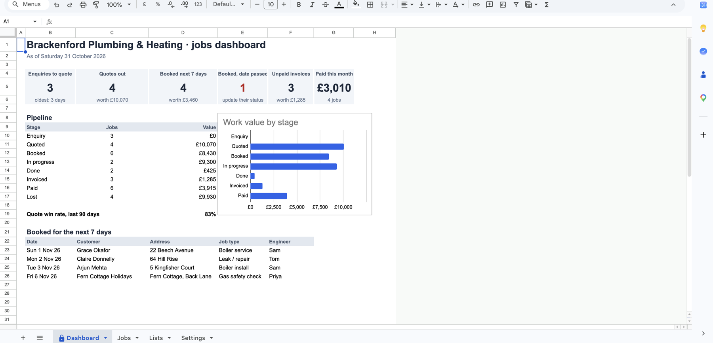
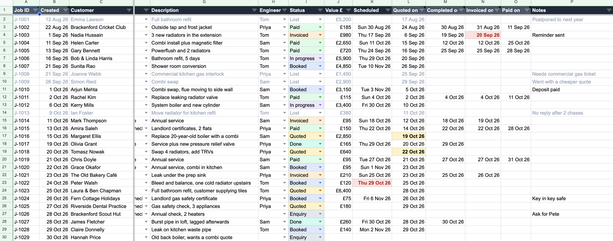
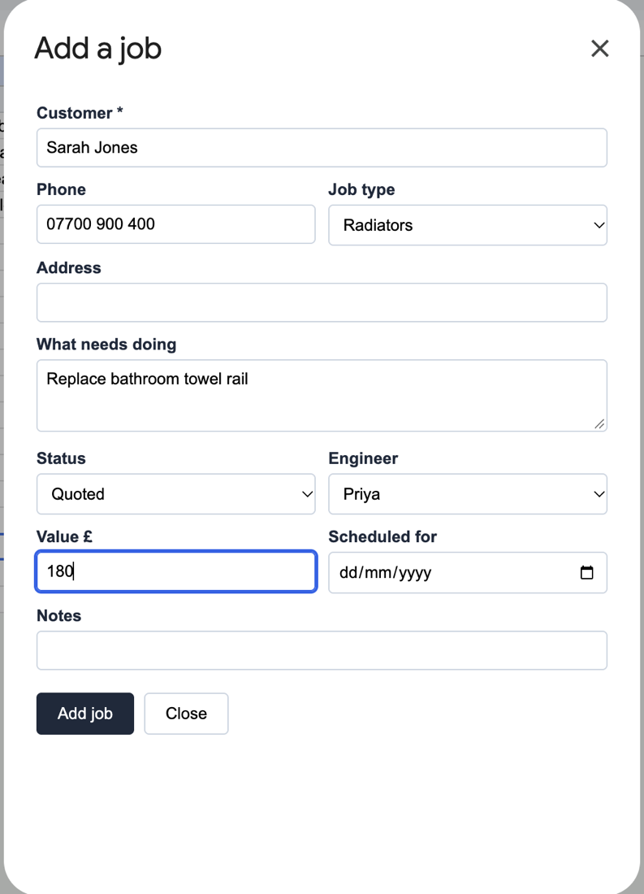
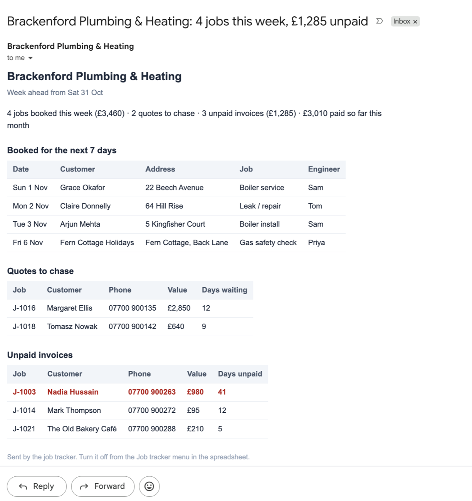
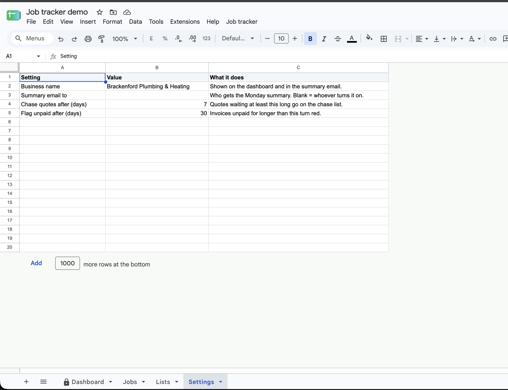

# trades-job-tracker

A job tracker for a small trades business, built entirely inside Google Sheets. No new app, no
logins for the team to remember and no monthly fee: it lives in the owner's own Google account.

The demo is a fictional plumbing and heating firm with 30 jobs, from first enquiry to paid
invoice. All names, addresses and phone numbers are made up (the phone numbers are in Ofcom's
07700 900xxx range, which is reserved for drama and never issued).





## What it does

| | |
|---|---|
| **Jobs tab** | One row per job. Dropdowns for job type, engineer and status, and each status has its own colour. Filter or sort by any column. |
| **Dates fill themselves in** | Change a job to *Quoted*, *Done*, *Invoiced* or *Paid* and that date is stamped automatically. Type a customer on a new row and it gets the next job number. |
| **"Add a job" form** | *Job tracker → Add a job…* opens a simple form, so nobody has to scroll to the bottom of the sheet. Checks the input before saving. |
| **Dashboard** | Enquiries to quote, quotes out, jobs booked this week, unpaid invoices and money paid this month, plus value by stage and the quote win rate. |
| **Warnings** | Red when a booked job's date has passed without an update, or an invoice is overdue. Amber when a quote needs chasing. |
| **Monday email** | At 7am every Monday: this week's jobs, quotes to chase and unpaid invoices, sent to the owner. |
| **Settings tab** | Business name, who gets the email, and when quotes and invoices count as late. Changing them needs no code. |

Columns are found by their heading, not their position, so the owner can move columns or add
their own without breaking anything.

<p>
  
  &nbsp;
  
</p>



## How it's built

- **Dashboard:** Google Sheets formulas (`COUNTIFS`, `SUMIFS`, `FILTER`, `SORT`). It recalculates
  live, so it is always up to date even if the script is never run.
- **Behaviour:** Google Apps Script in [`apps-script/`](apps-script). It provides the menu, the form,
  the automatic dates and the Monday trigger. The script is limited to this one spreadsheet
  (`@OnlyCurrentDoc`).
  - [`Logic.gs`](apps-script/Logic.gs): the rules (stamping, job numbers, summary, form checks). These
    use no Google services, so they can be tested anywhere.
  - [`Code.gs`](apps-script/Code.gs): connects those rules to the sheet, the email and the triggers.
  - [`NewJob.html`](apps-script/NewJob.html): the form.
- **Set-up:** [`build_sheet.py`](build_sheet.py) creates the four tabs with their formatting,
  dropdowns, colour rules, chart and demo data. A fresh copy for a new business takes about a
  minute instead of an afternoon of clicking.

## Tests

| | Checks |
|---|---|
| `npm test` | 23 tests. The rules in `Logic.gs`, plus `Code.gs` running against a stand-in for Google's services: which cells get written, the email, and the Monday trigger. |
| `pytest` | 15 tests on the builder. The demo dates make sense for each status on any day it's built (month ends, leap day, New Year), and every request stays inside its tab. |
| `python tests/live_check.py SHEET_ID` | Builds the demo in a real Google Sheet. Then it works out every dashboard number and list again in Python and compares them with what Google calculated (39 checks). |

## Set it up in your own Google Sheet

1. **Make the tabs.** Create a blank Google Sheet. Share it (Editor) with a Google service
   account; [api-sheets-sync](https://github.com/privatemoose15/api-sheets-sync#google-setup-one-off-about-5-minutes)
   explains how to create one. Then run:

   ```bash
   pip install -r requirements.txt
   python build_sheet.py --sheet-id YOUR_SHEET_ID
   ```

   The builder sets the sheet to UK date format and London time. It refuses to touch a sheet that
   already has Dashboard, Jobs, Lists or Settings tabs, unless you add `--reset` (which rebuilds
   them and loses what was in them).

2. **Add the script.** In the sheet, open **Extensions → Apps Script**:
   - replace everything in `Code.gs` with [`apps-script/Code.gs`](apps-script/Code.gs)
   - **+ → Script**, name it `Logic`, and paste [`apps-script/Logic.gs`](apps-script/Logic.gs)
   - **+ → HTML**, name it `NewJob`, and paste [`apps-script/NewJob.html`](apps-script/NewJob.html)
   - click **Save**

3. **Reload the sheet.** A **Job tracker** menu appears. The first time you use it, Google asks
   for permission:

   | Google asks to… | Because |
   |---|---|
   | See and edit this spreadsheet | Adding jobs and filling in dates. This one sheet only. |
   | Display content in prompts and sidebars | The "Add a job" form |
   | Send email as you | The Monday summary |
   | Run when you are not present | The Monday trigger |
   | See your email address | Sending the summary to you |

   Because the script is your own and not published, Google first shows "Google hasn't verified
   this app". Click **Advanced → Go to … (unsafe)**. This is normal for a private script.

4. **Optional:** **Job tracker → Turn on Monday summary email.**

## Using it day to day

- **New job:** use **Job tracker → Add a job…**, or type the customer's name on the first empty
  row.
- **Moving a job on:** change its **Status**. The dates fill themselves in.
- **Red** means it needs action now. **Amber** means it's worth a phone call.
- **Don't rename** the column headings or the statuses *Quoted*, *Done*, *Invoiced* and *Paid*. The
  script finds things by those names, and Google shows a warning if you try. Adding new statuses,
  job types or engineers on the **Lists** tab is fine.

## Files

```
build_sheet.py          creates the tabs, formatting, rules, chart and demo data
apps-script/            paste these into Extensions → Apps Script
  Code.gs               menu, form handler, automatic dates, Monday email
  Logic.gs              the rules, with no Google services so they can be tested
  NewJob.html           the "Add a job" form
  appsscript.json       project settings (for clasp users; not needed when pasting)
tests/
  logic.test.js         rules
  code.test.js          Code.gs + Logic.gs together against stand-in Google services
  test_build.py         builder
  live_check.py         real-sheet check
```
